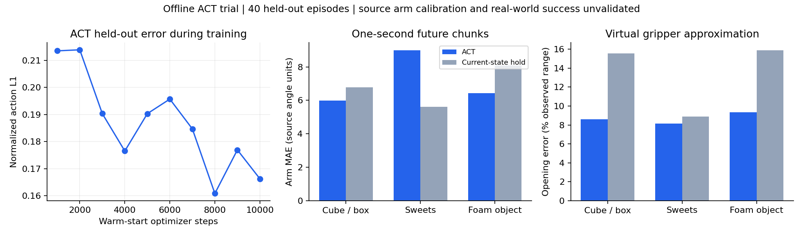

# Experimental ACT from public SO-100 demonstrations

This separate offline experiment trains the official LeRobot ACT architecture on three public pick-and-place datasets, with a virtual four-joint Eka gripper remap. It does not replace the Isaac Lab PPO/SGS learner or drive hardware.

**Results are mixed:** in the broader held-out evaluation, ACT improves arm prediction over current-state hold for cube/box and foam-object recordings but loses on sweets. Source-macro arm error is 7.14 versus 6.82 for hold, or 4.6% worse. Virtual opening error improves from 13.44% to 8.70% of the observed range. No grasp-success, physical calibration, independent finger dexterity or wrist-camera transfer is established.

- [Results and limitations](REPORT.md)
- [Original experiment setup and data contract](ARCHIVE_README.md)
- [Original runtime versions](runtime-versions.json)
- [Publication hashes and verification](publication-manifest.json)
- [Checkpoint release](https://github.com/Jdowdy05/HiWonder-IsaacLab/releases/tag/act-public-pickplace-2026-10-29)



## Data and model

200 episodes and 81,290 frames at 30 Hz from [cube/box](https://huggingface.co/datasets/lerobot/svla_so100_pickplace), [sweets](https://huggingface.co/datasets/jmrog/so100_sweet_pick), and [foam-object](https://huggingface.co/datasets/nbaron99/so100_pick_and_place4) recordings. Immutable dataset revisions, original license cards and SHA256 receipts are in `provenance/`. Original selected-camera videos and trajectory data remain downloadable through `experiment_data.py`; raw datasets are excluded from Git.

Training uses 160 complete episodes, with 40 held out. ACT has 51,567,497 parameters, ImageNet ResNet18, 30-frame chunks, one exterior camera resized to 224x168, and nine state/action coordinates. Source-balanced sampling and all normalization/gripper endpoint estimates use training episodes only.

The five arm coordinates retain their original source reference frames. Source gripper direction is inspected separately, and the one recorded opening is mapped into four coupled virtual finger angles. Those labels are not independent motor measurements or a calibrated physical hand model.

12,000 optimizer updates were executed across two runs. The selected model descends from the first run's step 1750 and the second run's step 8000, for 9750 updates in its direct lineage. The best checkpoint's SHA256 is `1cd16e2645e244322d32651d7fb1ca9ce91727cfd887f358e408b58e92f63053`.

## Download the checkpoint

The prerelease includes `ACT-PickPlace-Eka-Experimental.zip` and its SHA256 sidecar. The archive contains the original checkpoint, experiment code, reports and provenance; it excludes raw videos, environment packages and optimizer states. The code and documentation committed here include repository-oriented setup instructions added at publication time, while the release preserves the original experiment bundle.

```powershell
gh release download act-public-pickplace-2026-10-29 --repo Jdowdy05/HiWonder-IsaacLab --pattern 'ACT-PickPlace-Eka-Experimental.zip*' --dir ./act-download
Get-FileHash ./act-download/ACT-PickPlace-Eka-Experimental.zip -Algorithm SHA256
```

Expected archive SHA256: `794c2c3f1ccf6a6d2e8ede957359ae59f89f585a5c9b11c8cd0eff8f72229d78`.

Extract the archive to a separate directory. Its `trial-02/best/` contains `config.json`, `model.safetensors`, `data_contract.json` and `experiment_state.json`. If placing weights beside this repository's experiment, copy only that checkpoint directory to `trial-02/best/`; retain the repository's newer README. The same checkpoint metadata is tracked here without the large weights file. Git ignores extracted weights and archives.

`data_contract.json` is required: preprocessing and output normalization are external to ACT. `model_io.load_policy_checked` loads all parameters strictly on the requested device. Inputs are normalized nine-value state plus an ImageNet-normalized scene image. Outputs are normalized absolute targets, not the Isaac Lab environment's incremental actions.

## Set up a separate training environment

The following commands run from the repository root on Windows with Python 3.12, Git, uv and a CUDA-compatible NVIDIA driver. They create a separate environment; they do not update the Isaac Lab environment. The original trial used an existing read-only PyTorch installation plus private dependencies, as documented in `ARCHIVE_README.md`. A new CUDA installation is not part of publication validation.

```powershell
uv venv --python 3.12 .work/act-public-pickplace-2026-10-29/.venv
$python = (Resolve-Path .work/act-public-pickplace-2026-10-29/.venv/Scripts/python.exe).Path
uv pip install --python $python 'torch==2.11.0' 'torchvision==0.26.0' --index-url https://download.pytorch.org/whl/cu130
uv pip install --python $python 'lerobot @ git+https://github.com/huggingface/lerobot.git@7e241bd630a3719a56157a497ce5d08f244784f1' 'numpy==2.2.6' 'pyarrow==26.0.0' 'av==15.1.0' 'pytest>=8,<10' psutil matplotlib

$experiment = 'experiments/act-public-pickplace-2026-10-29'
& $python "$experiment/experiment_data.py" download --root .work/act-public-pickplace-2026-10-29/datasets
& $python "$experiment/experiment_data.py" prepare --root .work/act-public-pickplace-2026-10-29/datasets --cache .work/act-public-pickplace-2026-10-29/cache
$env:PYTEST_DISABLE_PLUGIN_AUTOLOAD = '1'
$env:CUDA_VISIBLE_DEVICES = '-1'
& $python -m pytest "$experiment/test_experiment.py" -q
& "$experiment/Train-ACT-Trial.ps1" -Steps 10000
```

The PowerShell launcher selects CUDA device 0, starts a new output directory and applies the resource guard. The guard limits only its own process tree to 6 GiB RSS, preserves 4 GiB available RAM, and enforces a 30-minute maximum wall time. Actual main trials peaked around 2.5 GiB RSS. No GPU training is started by cloning this repository.

Warm starts intentionally use a fresh optimizer/RNG and require exactly matching data/normalization contracts. Existing original-machine data-contract hashes contain absolute provenance paths; a fresh preparation in a new checkout will produce a different contract and may therefore reject `--initialize-from` with archived weights. Evaluate the archived checkpoint with its saved contract, or start a fresh training run. Do not weaken that check to imply exact replay.

## Verification boundary

The original training/save/reload checks, resource logs, fixed-anchor validation and broader phase-coverage evaluation are preserved here. The 14 CPU tests also passed again during publication on 2026-11-02. Model weights and release bytes are verified against their saved hashes. No new training, hardware motion, simulator rollout, or Isaac Lab compatibility claim is included in publishing this experiment.

Public data variation provides useful visual diversity, but these validation episodes share the recorded camera setups with training. Independent finger control, new wrist-camera appearance, physical joint calibration and closed-loop task success need separate validation before deployment or RL transfer.
