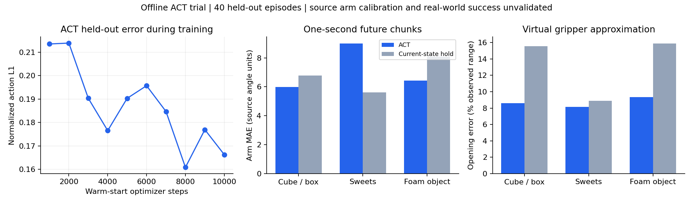
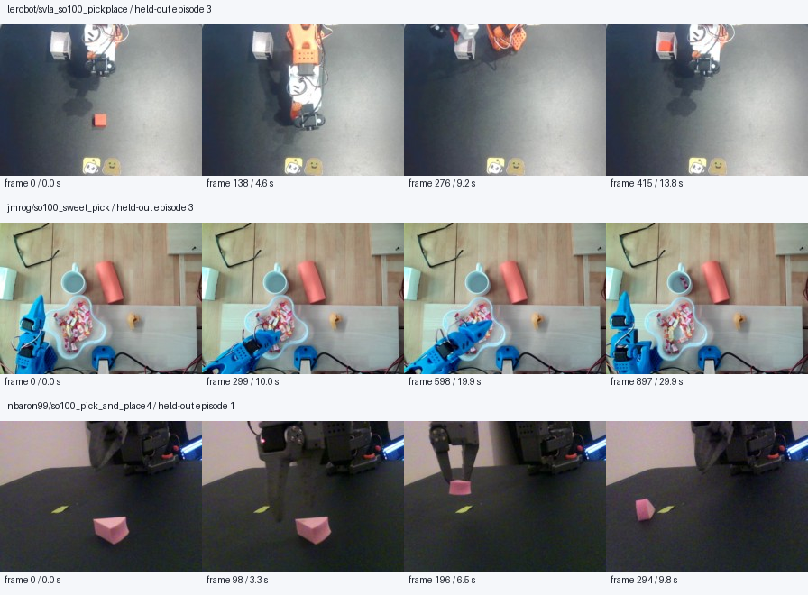

# ACT public pick-and-place trial results

Completed 2026-10-29 on this Windows RTX 5090 workstation. This is an offline imitation-learning trial with a virtual Eka gripper remap.

## What was downloaded and trained

- Three pinned Apache-2.0 SO-100 datasets: 200 episodes, 81,290 frames at 30 Hz; 160 training and 40 held-out episodes.
- Original selected-camera videos, trajectory data, metadata and license cards retained: 317 files, 1,651,599,737 bytes.
- Actual official LeRobot ACT model: 51,567,497 parameters, ImageNet ResNet18, 30-frame action chunks, nine state/action coordinates, batch eight, BF16 autocast with FP32 parameters.
- Ran 2,000 steps, then 10,000 additional warm-start steps with a fresh optimizer. The chosen initializer was phase1 step 1750; the final best checkpoint is phase2 step 8000. The selected weights therefore have 9,750 optimizer updates in their direct lineage; 12,000 updates were executed overall.
- Best weights: `trial-02/best/model.safetensors`, SHA256 `1cd16e2645e244322d32651d7fb1ca9ce91727cfd887f358e408b58e92f63053`.

## Held-out prediction results

The primary phase-coverage evaluation samples 16 distinct frames uniformly per held-out episode: 640 anchors and 18,276 valid future targets. Padding is masked. ACT sees observations only and uses its inference prior, not the demonstration-conditioned VAE posterior. These are the same held-out episodes used for checkpoint selection, so this is not an independent unseen-domain test.

| Recorded setup | ACT arm MAE | Hold arm MAE | ACT opening error | Hold opening error |
|---|---:|---:|---:|---:|
| Cube / box | 5.98 | 6.79 | 8.58% | 15.55% |
| Sweets | 9.00 | 5.61 | 8.16% | 8.88% |
| Foam object | 6.44 | 8.08 | 9.36% | 15.90% |

Arm MAE is averaged over five recorded arm coordinates and valid frames in each future one-second chunk. Its units are the source angle encoding; they are not calibrated HiWonder joint-angle errors. Opening error is relative to each source's observed training range, not millimeters of jaw gap.

ACT improves arm prediction over current-state hold in two of three sources, but its source-macro arm MAE is 7.14 versus 6.82 for hold (4.6% worse overall). Virtual opening MAE is 8.70% versus 13.44% for hold. Results are mixed; this does not establish a successful pick-and-place controller.

Phase-coverage normalized L1 is 0.1972. Replacing images with ImageNet-mean RGB raises it to 0.2865 (45.3% higher). Images influence predictions; this out-of-distribution ablation does not prove correct object tracking or robustness.

The four-fixed-anchors-per-episode metric used during training selected a checkpoint at L1 0.1609. Its different phase weighting explains why this number differs from the 16-uniform-anchors result above. See `uniform-heldout-validation.json`, `RESULTS.json`, run summaries and raw `metrics.jsonl` files.

## Resource and correctness evidence

- Phase1 guarded wall time 104.1 s; phase2 458.9 s. These are local trials sharing the GPU with an existing job, not a rental GPU benchmark.
- Peak process-tree RAM across main phases: 2.50 GiB. Minimum available RAM: 9.57 GiB. Neither guard triggered.
- Phase2 peak PyTorch allocated CUDA memory: 1.00 GiB. This excludes driver/context memory and other running jobs.
- Saved/reloaded same-device inference maximum absolute difference: 0.0 for the smoke and both training trials.
- 14 CPU tests passed, including actual process timeout ownership, missing-parameter rejection and CPU loading of CUDA-tagged ACT checkpoints. PowerShell entry point parses successfully.
- An independent review found and resolved three P2 issues: outer wall-time default, strict report checkpoint loading, and requested-device routing before loading. Corresponding red/green regression checks passed.
- The pre-existing TinyDog training PID24140 was observed alive after the experiment; no unrelated jobs were stopped.

## What still needs validation

- The five arm values retain source reference frames. Cross-source physical zero/sign/scale calibration is unavailable; approximate recorded-frame learning is not mechanical retargeting.
- Four virtual finger labels derive from one gripper opening. Independent finger dexterity has not been demonstrated or learned from these recordings.
- Different recorded gripper directions were inspected and mapped separately. Observed-range endpoints are heuristics, not measured physical stops or object-contact geometry.
- Training images show original stock grippers and exterior cameras. New-hand appearance and the custom wrist camera remain a domain shift.
- There is no simulator rollout, grasp-success measurement, physical robot deployment, or RL post-training in this trial. Existing Isaac Lab PPO/SGS code and hardware setup were not changed.
- ACT weights are not directly compatible with the existing PPO actor or incremental-action interface. RL needs an ACT-compatible learner or an explicit policy-distillation bridge.

The next meaningful test is a calibrated retargeting and closed-loop rollout on a matching pick-and-place task, comparing a single-source baseline with this mixed-source checkpoint. More recorded variation can help, but consistent action semantics and task goals remain necessary.

See README.md for sources, preprocessing, interface, environment and reproducible commands.
